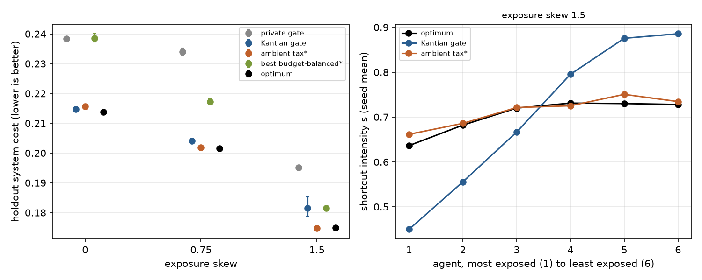

# Kant fix it

**Can a conscience stop self-improving AI agents from wrecking a shared system, or does it take a price?**

Six agents share one system. Each one keeps changing its own policy, testing
each change and keeping the ones that make *it* better off. Changes that help
their owner can hurt everyone else, so the system drifts somewhere worse than
anyone wanted.

This project holds everything fixed (the agents, their search budget, the
environment) and changes one thing: the rule that decides whether an agent
keeps a change. A selfish rule is compared with a Kantian one ("would I still
want this if every agent did the same?"), with welfare rules, and with prices
an operator could charge instead.

Project page: **[kant-fix-it-web.vercel.app](https://kant-fix-it-web.vercel.app)**

## What came out

Five pre-registered studies, 4,190 confirmatory runs, two environments:

* **The rule matters.** In a simulated interbank payment network, selfish
  agents leave the system 29 % costlier than a planner. The Kantian rule
  closes about half of that gap.
* **A price matters more.** A simple charge on payment delay beat every rule,
  including the best one, with simple and with richer agent policies.
* **When the harm can be hidden, simple prices get gamed.** In a shared
  codebase, where shortcuts add hidden coupling and incidents land anywhere, a
  charge on *visible* coupling taught agents to hide it: 99 % of the coupling
  went underground and costs rose by more than half.
* **The Kantian rule only works while agents are alike.** With equal exposure
  it matched a tax on shared damage. When some modules absorb most of the
  incidents, "what if everyone did this?" measures what an agent would suffer,
  not what it causes. The exposed agents froze, the sheltered ones ran wild,
  and the tax won. That held on every scale tested for "the same change".

So: Kant can't fix it, but a well-chosen price can.



## How it was kept honest

* Every confirmatory study was **pre-registered**: hypotheses, analysis code
  and a decision rule were committed before the runs. The commit hashes cited
  in each protocol are the timestamps.
* Pilots used separate seeds and a separate scenario split. Results are
  scored on held-out scenario families never seen during evolution.
* Failed predictions are reported as failed: 7 of 29 registered predictions
  failed, six outright and one in part.
* Analysis scripts regenerate every reported number exactly from the stored
  records; 82 tests cover accounting, determinism and protocol isolation.

## Read more

* [docs/REPORT.md](docs/REPORT.md): the full report.
* [docs/PROJECT.md](docs/PROJECT.md): decisions, audit trail and open
  questions.
* [docs/LITERATURE_REVIEW.md](docs/LITERATURE_REVIEW.md): prior work, with
  search logs in `docs/literature_notes/`.
* Protocols, each frozen before its runs:
  [E1–E6](docs/PREREGISTRATION.md), [E8](docs/PREREGISTRATION_E8.md),
  [E9](docs/PREREGISTRATION_E9.md), [E10](docs/PREREGISTRATION_E10.md),
  [E11](docs/PREREGISTRATION_E11.md).

Both environments are simulators only. No real payment system, codebase,
data or money is involved, and the results say nothing about any real system.

## Run it

Needs Python 3.12 and [uv](https://docs.astral.sh/uv/).

```bash
uv sync
uv run pytest
uv run python -m evortgs.experiments E1 E2 E3 E4 E5 E6 E7 E8
uv run python -m evortgs.analysis
uv run python -m evortgs.analysis_e8
uv run python -m evortgs.cb_experiments cbpilot E9
uv run python -m evortgs.analysis_e9
uv run python -m evortgs.cb_experiments cbpilot2 cbpilot3 E10
uv run python -m evortgs.analysis_e10
uv run python -m evortgs.cb_experiments unitspilot E11
uv run python -m evortgs.analysis_e11
```

The full set takes about four hours on a laptop. On a machine with little free
memory, set `EVO_WORKERS=4 OPENBLAS_NUM_THREADS=1`.

## Layout

```
src/evortgs/sim.py             payment settlement engine, costs, invariants
src/evortgs/scenarios.py       payment scenario families, development/holdout split
src/evortgs/evolve.py          gated evolution loop
src/evortgs/gates.py           the same loop for any environment, with Kantian scales
src/evortgs/codebase.py        shared-codebase environment and instruments
src/evortgs/evaluate.py        locked holdout evaluation (payments)
src/evortgs/cb_evaluate.py     locked holdout evaluation (codebase)
src/evortgs/experiments.py     payment experiments
src/evortgs/cb_experiments.py  codebase experiments, planners
src/evortgs/analysis*.py       pre-registered statistics and figures
tests/                         accounting, determinism, protocol isolation
runs/                          one JSON line per run, results and figures
```

The Python package keeps its working name, `evortgs`.

## Licence

MIT. See [LICENSE](LICENSE).
