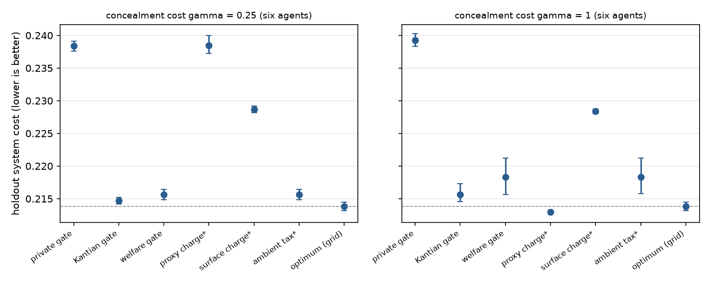
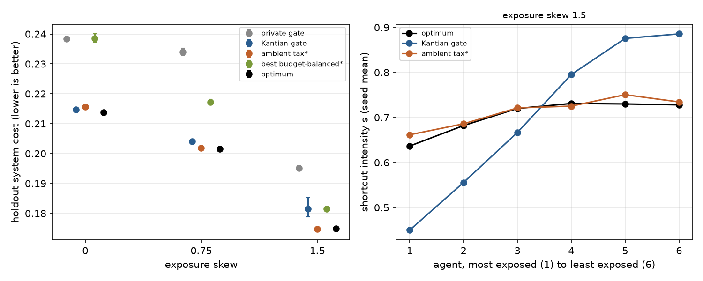

# EvoRTGS — canonical project document

Single source of truth for decisions, evidence, status and open questions.
Supersedes the handoff of 17 November 2026 where they conflict.
Last updated: 18 November 2026. Status: concluded.

Related files: [PREREGISTRATION.md](PREREGISTRATION.md),
[PREREGISTRATION_E8.md](PREREGISTRATION_E8.md) and
[PREREGISTRATION_E9.md](PREREGISTRATION_E9.md),
[PREREGISTRATION_E10.md](PREREGISTRATION_E10.md) (frozen protocols),
[REPORT.md](REPORT.md) (final paper-style write-up), `runs/` (raw records,
`results.json`, `results_e8.json`, `results_e9.json`, `results_e10.json`). The next-stage working
notes of 17 November 2026 are folded into §7 and §9; that file is deleted.

---

## 1. Where the project stands

| Item | Status |
|---|---|
| Novelty audit | Done at the level of a targeted review, not a systematic one (§3) |
| Research question | Narrowed and frozen (§2) |
| Simulator, evolution loop, evaluator | Built, 40 tests passing |
| Pre-registration | Committed before confirmatory runs (`4d6ebe9`) |
| Confirmatory experiments E1–E6 | Run, 950 runs, analysed (§5) |
| Post hoc ablation E7 | Run, labelled exploratory (§5.7) |
| Rule-level policies, second pre-registration | Committed before E8 runs (`9729748`) |
| Confirmatory experiment E8 (gates against pricing) | Run, 520 runs, analysed (§5.8) |
| Second environment (shared codebase, hidden coupling) | Built, 24 further tests (64 in total) (§5.9) |
| Pre-registration for E9 | Committed before confirmatory runs (`0b9a282`) |
| Confirmatory experiment E9 (gates against the best available instrument) | Run, 1 280 runs, analysed (§5.9) |
| Pre-registration for E10 (unequal exposure) | Committed before confirmatory runs (`f580a13`) |
| Confirmatory experiment E10 | Run, 1 080 runs, analysed (§5.10). **Strong gates line closed** |
| Final write-up | REPORT.md rewritten as a standalone report; every number re-checked against regenerated results (18 November 2026) |
| **Project status** | **Concluded.** The owner chose to write up and stop (D29). Nothing pushed or published |
| Language-model proposers | Not started, by decision (D29, §7) |
| External replication, peer review | None |

One-sentence state: acceptance gates do not beat the best available
instrument — a delay price beats them in payments, and in a shared codebase
with unattributable harm a budget-breaking ambient tax ties them when agents
are alike and beats them when agents are unequally exposed (E10, the
pre-registered rule closes the line); what survives is narrower: where only
budget-balanced charges are possible and the harm's carrier can be hidden, an
own-cost gate does better than those charges, by a margin that shrinks as
exposure becomes unequal. No novelty claim is made.

## 2. Direction taken, and why it differs from the handoff

### 2.1 What was dropped

The handoff's H1 had two halves. Both fail as novelty claims:

* *"Independently improving banks can worsen system outcomes."* This is the
  textbook result of the payment-timing literature: Bech and Garratt (2003)
  show the intraday liquidity game is a prisoner's dilemma or stag hunt
  depending on credit policy, and Galbiati and Soramäki (2008/2011) find
  learned equilibrium liquidity below the efficient level over a wide range of
  costs. It can serve as a validity check for a simulator, not as a finding.
* *"An adaptive system-aware coordinator reduces the trade-off."* A planner
  that adapts rules while agents learn is the two-level structure of
  learned-mechanism-design work (for example the AI Economist line), and
  FRAIL (2026) already tests stabilising mechanisms for LLM agent societies in
  financial coordination games. "Adaptive coordinator" was also undefined
  enough to be rescued by any outcome.

The 2 × 2 design (fixed/evolving × fixed/adaptive) was therefore replaced.

### 2.2 What replaced it

Every self-improvement loop — DGM, Hyperagents, CORAL, AIDE², MASS, and the
financial skill-evolution systems — has the same skeleton: propose a change,
evaluate it, accept or reject. The published systems evaluate against a fixed
benchmark. When several such loops run in a shared environment, each
acceptance changes the environment the others are evaluated in, and "verified
improvement" stops being well defined. The **acceptance gate** is then a
design object in its own right.

**Research question.** Holding the proposal mechanism, the search budget and
the environment fixed, how much of the efficiency loss from independent
self-improvement is removed by changing only the acceptance gate, and what
information does each gate need?

Gates are ordered by what they must observe:

1. private gate — own cost, unilateral change (κ = 0);
2. universalization gate — own cost in the counterfactual where every agent
   makes the same shift (κ = 1). This is the acceptance-rule form of Roemer's
   Kantian optimisation and of Alger and Weibull's *homo moralis* with degree
   of morality κ; intermediate κ gives a dose-response test;
3. gates that read everyone's costs — unilateral welfare, joint welfare,
   no-harm;
4. the classical remedy that leaves the gate private and changes the game —
   an operator surcharge on delay.

EvoRTGS stays as the test environment because the payment-timing game has
known theory to validate against and a natural operator who could impose a
gate or a fee.

### 2.3 Honest assessment of the contribution

* The game theory is not new. Universalization as *decision-time prompting*
  for LLM agents exists (GovSim, NeurIPS 2024; an ICML 2026 workshop paper on
  Kantian equilibrium). Universalization as the *selection rule of a
  self-evolution loop*, compared at matched budget against welfare gates and a
  Pigouvian baseline with held-out shocks, was not found in the search. That
  is "not found", not "does not exist".
* The realistic contribution type is **empirical plus testbed**, not a new
  algorithm. The main result below includes a negative: a plain delay
  surcharge with selfish gates does as well as the best gate.
* Nothing here is evidence about recursive self-improvement in the strong
  sense. The agents tune three numbers; the loop itself does not change.

## 3. Novelty audit

### 3.1 Method and limits

Sources: web search (17 Nov 2026) plus direct reads of arXiv abstract pages,
the BIS project page, one GitHub repository and one conference page. Full
texts were read only for FRAIL (partly) and GovSim (partly). Two PDFs
(Galbiati–Soramäki; Castro et al.) could not be text-extracted and are cited
from abstracts and catalogue text only. OpenReview was blocked. This is a
targeted review. Blind spots: SSRN, central-bank working papers not indexed
by the search engine, non-English sources, anything published in the last few
weeks, and the full texts of most 2026 preprints.

### 3.2 Verified facts

| Work | Verified | Relevance |
|---|---|---|
| CORAL, arXiv 2604.01658 (v3 Sep 2026) | exists; multi-agent evolution infrastructure with evaluator separation | evolution loop against fixed graders; no strategic interaction between owners |
| Hyperagents, arXiv 2603.19461 | exists; editable meta-level | single lineage, fixed benchmarks |
| MASS, arXiv 2610.12176 | exists; workflow search + fine-tuning on own trajectories | same |
| AIDE², arXiv 2609.26457 | exists; reports reward hacking falling 55 %→32 % (author-reported) | same; shows gate integrity matters |
| Misevolve, arXiv 2509.26354 (ICLR 2026) | exists | single-agent evolution going wrong; not multi-principal externalities |
| Co-evolution survey, arXiv 2608.10299 | exists; abstract does not mention social dilemmas or multi-principal externalities (body not read) | closest taxonomy |
| Internal vs. External, arXiv 2605.09128 | exists; evolved vs deliberated constitutions in public-goods games | evolution of *shared rules*, not of per-agent acceptance gates |
| Economy of Minds, arXiv 2606.02859 (NeurIPS 2026) | exists; auctions and bankruptcy as selection | economic selection inside one system |
| FRAIL, arXiv 2609.30940 | exists; bank run, debt rollover, crowdfunding; three commitment mechanisms; agents appear to be fixed-policy LLMs; no payment network | closest on "financial coordination failure + stabilisers"; no policy evolution |
| FinEvo-Bench, arXiv 2608.06144 | exists; longitudinal single-agent professional tasks | not interactive |
| BIS Project Agenti | page exists, "ongoing", last updated 14 Oct 2026; describes an RTGS-like agentic simulator that "will be used"; no code, no results | closest institutional overlap; cannot be compared or reused |
| BIS WP 1310 / BoC SWP 2025-35 | exists; single prompted agent, simple settings | not multi-agent |
| GovSim, arXiv 2404.16698 (NeurIPS 2024) | universalization is a sentence injected at decision time | closest on universalization |
| "Kantian Equilibrium in the Age of Multi-Agent Systems" (ICML 2026 workshop poster) | abstract only: Kantian prompting in a commons game | same; prompting, not selection |
| Bech & Garratt 2003; Galbiati & Soramäki 2008/2011; Castro et al. 2021/2025 | abstracts and catalogue text | the phenomenon and learning in payment games are established |
| PSSimPy (MIT, ICIS 2024 paper) | repository exists; queues, credit facility, strategic bank hook; small user base | candidate reference simulator for cross-validation |

Handoff items **not** re-verified here: ADAS, AFlow, AgentSquare, EvoAgentX,
Swarm Skills, Adaptive Orchestration, RSIAgent, RSIBench(-Data), AI4AI-Bench,
SEA-Eval, SEABench, FinSkillOps, FinSkillBench, EvolveTrade, EvoTS-Agent,
SHARP, MARS, MarketSim, the ECB bulletin, the IMF note, the Bundesbank
article, the BoE FSR and the FSB report. None of them bears on the narrowed
question except as background; cite only after checking.

### 3.3 Novelty map

* **Established:** self-modifying agents; workflow search; local optimisation
  harming payment-system efficiency; RL/LLM agents in payment settings;
  mechanisms that stabilise LLM financial games; universalization prompting.
* **Partial overlap:** homo-moralis/Kantian evolutionary theory (analytical,
  about preferences, not about acceptance rules in search loops);
  constitutional evolution for agent groups.
* **Not found:** acceptance gates of co-evolving agents compared as the
  experimental factor, with information requirements, matched budget,
  held-out shocks and a Pigouvian baseline.
* **Unknown:** full texts of the 2026 preprints; anything inside Project
  Agenti.

### 3.4 Prior art for the second environment (E9)

Checked 17 November 2026 by web search; abstracts and secondary descriptions,
not full texts.

* **Moral hazard in teams** (Holmström 1982): with output observed only in
  aggregate, no budget-balanced sharing rule gives efficient incentives; a
  budget breaker can.
* **Ambient taxes for non-point pollution** (Segerson 1988, J. Environ. Econ.
  Manag. 15): a charge on the aggregate outcome can induce efficient abatement
  without observing individual emissions. Known objections: agents may not see
  how they move the aggregate, the measurement is noisy, the result does not
  survive collusion, and payments are large (Millock and Salanié). Laboratory
  tests (Cochard, Willinger and Xepapadeas 2005; Vossler et al. 2008) find
  ambient taxes often work in aggregate, with mixed reliability across designs.
* **Multitask incentives** (Holmström and Milgrom 1991): paying on a measured
  dimension moves effort into unmeasured ones. The proxy result below is an
  instance.
* **Kantian optimisation** (Roemer 2015, 2019): Kantian equilibria are
  efficient in symmetric common-pool problems with negative externalities. The
  Kantian gate reaching the optimum in E9 is therefore expected, not a finding.
* **Technical debt as a commons**: an informal framing in practitioner
  writing; one empirical study links non-owner changes to clones and debt
  (arXiv 2405.15866). No agent-based or game-theoretic simulation of it was
  found; that is "not found", not "does not exist".

Both sides of the E9 comparison are therefore known: the ambient tax is the
textbook instrument for this information structure, and Kantian optimisation
is known to be efficient in symmetric commons. E9 only tests them against each
other inside a propose–evaluate–accept loop with finite, noisy evaluation, and
against budget-balanced alternatives.

## 4. System

### 4.1 Architecture

```
scenarios.py   pure function (config, family, split, index) -> Scenario
sim.py         deterministic settlement engine and cost accounting
evolve.py      propose / evaluate / gate loop; sees only a DevSampler
evaluate.py    locked holdout evaluation with invariant checks on
experiments.py experiment definitions, parallel runner, JSONL records
analysis.py    pre-registered statistics, results.json, figures
```

Trust boundaries: a policy is three numbers in [0, 1] validated on every
call; scenarios and results are immutable; `evolve.py` cannot import the
evaluator or construct a holdout scenario (enforced by a test that parses its
source); development and holdout seeds are separated by a split tag in the
seed.

### 4.2 Model

Six banks (ten in a robustness run), 20 ticks, integer money, no intraday
credit, no liquidity-saving mechanism. A bank posts opening liquidity as a
fraction of its expected outflow, keeps a buffer, and may hold ordinary
payments for a number of ticks; time-critical payments go out on arrival.
Costs fall on the sender: liquidity 1, delay `d` per day, deadline miss 2,
unsettled at close 10. Conservation: total balances equal total posted
liquidity after every settlement; no balance is negative.

Holdout families: `base`, `surge`, `outage`, `late_heavy`, `hub`. Evolution
sees `base` development scenarios only.

### 4.3 Stack and what was left out

| Used | Why |
|---|---|
| Python 3.12, uv, lockfile | reproducible environment |
| NumPy, SciPy | arrays, bootstrap, Wilcoxon |
| pytest, Hypothesis | hand-computed cases and property tests of accounting |
| matplotlib | two figures |
| multiprocessing, JSONL, git | parallel runs and an append-only record with commit hash |

| Proposed in handoff | Decision |
|---|---|
| SimPy | not used; a 60-line tick loop is simpler to audit and test |
| Pydantic | not used; frozen dataclasses and one validator cover three floats |
| NetworkX, DuckDB, Parquet, SQLite | not needed at 1 000 runs |
| LangGraph, LangChain, LangSmith/Langfuse | no language model in the loop yet; revisit only if the proposer stage needs resumable long runs |
| Docker | no generated code is executed; revisit at code-level proposals |
| Streamlit/Next.js | no UI until there is a result worth browsing |
| CORAL | relevant when proposals become code edits by coding agents; not for parameter search |
| Jev, Laya | identities still unconfirmed; not needed |
| PSSimPy | not used as engine (speed, control of invariants); planned as an independent cross-check |

## 5. Results

All numbers: holdout system cost per unit of payment value, mean over five
families, 20 paired seeds, 95 % bootstrap intervals. Lower is better. 950
confirmatory runs; every evaluation simulation ran with invariant checks and
none failed.

### 5.1 Gate 2 first failed, then passed

The first scenario generator drew payments independently. Liquidity then
funded net positions, a bank that under-provided hurt only itself, and all
gates coincided (pilot, `pilot` split). After switching to balanced cyclic
flows — the realistic case in which turnover is many times liquidity — a
unilateral cut from the planner's liquidity level became privately profitable
and costly to others (best response to 0.40 is 0.20; symmetric
price-of-anarchy estimates 1.03–1.15). The dilemma is a property of the flow
structure, and the result below is conditional on it.

### 5.2 Arms (E1, homogeneous banks, d = 0.5)

| Arm | Reads | Cost | 95 % CI | Unsettled | Delay (ticks) | Liquidity |
|---|---|---|---|---|---|---|
| private κ=0 | own | 1.125 | 1.093–1.160 | 7.0 % | 5.66 | 0.22 |
| κ=0.25 | own | 1.060 | 1.030–1.089 | 6.4 % | 4.80 | 0.25 |
| κ=0.5 | own | 1.051 | 1.030–1.074 | 6.6 % | 3.80 | 0.26 |
| κ=0.75 | own | 1.014 | 0.993–1.035 | 6.1 % | 3.79 | 0.27 |
| universalization κ=1 | own | 0.997 | 0.973–1.021 | 5.9 % | 3.22 | 0.29 |
| welfare, unilateral | all | 1.051 | 1.010–1.100 | 6.5 % | 3.87 | 0.26 |
| no-harm | all | 0.901 | 0.881–0.921 | 5.1 % | 1.55 | 0.33 |
| welfare, joint | all | 0.864 | 0.851–0.878 | 3.2 % | 1.38 | 0.48 |
| private + surcharge 8 | own | 0.876 | 0.858–0.894 | 5.2 % | 0.96 | 0.29 |
| symmetric planner (reference) | all | 0.874 | 0.839–0.911 | 3.8 % | 3.12 | 0.39 |

### 5.3 Pre-registered hypotheses

| | Claim | Outcome |
|---|---|---|
| H1 | private gate is at least 5 % worse than the planner | **Supported.** +0.251 (0.196–0.308), +29 %, p < 10⁻⁵ |
| H2 | universalization gate closes at least half the gap | **Supported, barely.** 0.51 (0.41–0.63) |
| H2b | cost falls as κ rises | **Supported.** Spearman −0.58 (−0.69 to −0.48); means monotone |
| H3 | heterogeneity erodes the gain | **Refuted.** Closure 0.51 / 0.39 / 0.52 at heterogeneity 0 / 0.75 / 1.5; difference −0.004 (−0.18 to 0.17). No bank rank is worse off under κ=1 at any level |
| H4 | gain transfers to each unseen shock family | **Supported.** All five, Holm p ≤ 4×10⁻⁵; largest in `late_heavy` |
| H5 | one private defector among universalizing banks gains | **Refuted.** Own-cost change +0.002 (−0.004 to +0.008); system cost unchanged |
| H6 | universalization beats unilateral welfare (pilot-suggested) | **Supported.** −0.054 (−0.089 to −0.021) |

### 5.4 What the results say

1. **The gate matters.** With proposals, budget and environment fixed, the
   choice of gate moves system cost by 23 % (1.125 to 0.864).
2. **A gate that reads only the agent's own cost recovers about half the
   loss**, in every cost regime tried (closure 0.45–0.54, E3), with ten banks,
   with sequential updates (E5), and with three times the budget, where its
   margin over the private gate grows from 0.112 to 0.186 on the same seeds
   (E6).
3. **Evaluating joint moves matters more than reading others' costs.**
   Unilateral welfare (full information) is worse than universalization (own
   cost only); joint welfare is the best gate. The bottleneck in this game is
   that useful changes are only visible when several banks move together.
4. **The classical remedy is as good as any gate.** A delay surcharge chosen
   on development data, with every bank keeping a private gate, reaches 0.876
   — statistically indistinguishable from the planner reference (+0.002,
   −0.038 to +0.041) and from no-harm (p = 0.08), and 12 % better than the
   universalization gate. Anyone who can impose a gate can impose a fee, and
   the fee needs no change to the agents.
5. **Two predicted weaknesses did not show up.** Heterogeneity did not erode
   the universalization gate, and a lone defector did not profit. Both are
   absences of evidence at this budget and in a three-parameter policy space;
   the defector result in particular should not be read as "the gate is
   incentive compatible".

### 5.5 Deviations from the pre-registration and weaknesses found

* The symmetric planner is a weak reference: joint welfare beats it, and the
  surcharge and no-harm arms match it. Gap closure is reported as registered
  but understates the gap to the best achievable outcome.
* The planner's delay (3.1 ticks) shows its search had not converged on the
  hold parameter.
* **Acceptance is noise-dominated.** Gates accept whenever the estimated
  change is negative; with four candidates and sixteen scenarios, about five
  of six banks accept something every generation, even at the end. The
  no-harm gate accepts 3.2 of 6 and may owe part of its advantage to being
  conservative. This motivated E7.
* Residual unsettled value is 3–7 %, far above real systems, because there is
  no liquidity-saving mechanism and no end-of-day credit.

### 5.6 Robustness

| Check | Private | Universalization | Unilateral welfare |
|---|---|---|---|
| d = 0.1 | 0.994 | 0.905 | 0.950 |
| d = 2 | 1.074 | 0.949 | 1.014 |
| d = 6 | 1.086 | 1.008 | 1.042 |
| sequential updates | 1.123 | 0.985 | 1.054 |
| ten banks | 1.143 | 0.984 | 1.074 |
| 120 generations (10 seeds) | 1.125 | 0.939 | 1.040 |

### 5.7 E7 — post hoc, not pre-registered

Added after seeing the confirmatory results, to test whether the gate ranking
is an artefact of noisy acceptance. Each gate accepts only if the paired
t-statistic of its score is below −2. Same seeds, budget and regime.

| Arm | Cost | 95 % CI | Accepted per generation (of 6) |
|---|---|---|---|
| private κ=0 | 1.538 | 1.493–1.584 | 1.25 |
| welfare, unilateral | 1.348 | 1.312–1.389 | 0.89 |
| no-harm | 1.290 | 1.222–1.360 | 1.03 |
| universalization κ=1 | 1.249 | 1.224–1.272 | 1.30 |
| private + surcharge 8 | 1.117 | 1.082–1.155 | 1.50 |

* The ordering private > unilateral welfare > universalization > surcharge
  survives (κ=1 vs κ=0: −0.289, −0.338 to −0.240; surcharge vs κ=1: −0.133,
  −0.168 to −0.093).
* The no-harm gate's advantage over universalization does **not** survive
  (+0.041, −0.029 to +0.113). Its E1 ranking should be treated as unreliable.
* Every thresholded arm is far worse than its unthresholded counterpart at
  this budget: strict acceptance starves the search within 40 generations.
  Permissive, noisy acceptance was the better search strategy here. Whether
  that reverses at larger budgets is untested.

### 5.8 E8 — gates against pricing with rule-level policies (pre-registered)

Protocol: [PREREGISTRATION_E8.md](PREREGISTRATION_E8.md), frozen in `9729748`
after a pilot on separate seeds (`runs/pilot2.jsonl`). Policies become eight
numbers: opening liquidity, morning and afternoon buffers, hold time, an
opening tick, a size threshold, a hold time for large payments and a bilateral
net sending limit. The three-parameter space is exactly nested in it (tested).
Budget, environment and seeds are those of E1. A second, coarser price was
added: a two-band tariff charged on value settled in the second half of the
day. Price levels are chosen on development cost and reported on holdout.

| Arm | Three parameters | Eight parameters |
|---|---|---|
| private gate | 1.125 (1.093–1.160) | 1.145 (1.113–1.179) |
| universalization gate | 0.997 (0.973–1.022) | 1.022 (1.008–1.037) |
| welfare gate, unilateral | 1.051 (1.010–1.100) | 1.059 (1.033–1.087) |
| welfare gate, joint | 0.864 (0.851–0.878) | 0.929 (0.911–0.952) |
| private + delay surcharge (level 16) | 0.815 (0.804–0.829) | 0.863 (0.850–0.876) |
| private + band tariff (level 4 / 2) | 0.845 (0.835–0.857) | 0.979 (0.952–1.008) |
| symmetric planner (reference) | 0.874 (0.839–0.910) | 0.934 (0.911–0.958) |

The four gate arms in the three-parameter column reproduce E1 to the last
digit, which confirms the engine extension did not change existing behaviour.

| Hypothesis | Outcome |
|---|---|
| R1 pricing still matches or beats gates | **Supported.** Surcharge vs universalization −0.159 (−0.180 to −0.138); vs joint welfare −0.066 (−0.091 to −0.045) |
| R2 gates degrade with richness more than pricing | **Not supported.** Interaction +0.017 (−0.013 to +0.049). Joint welfare worsens by 0.065, the surcharge by 0.048 |
| R3 gate ordering survives | **Supported.** Universalization vs private −0.123 (−0.148 to −0.099); vs unilateral welfare −0.037 (−0.060 to −0.015) |
| R4 the coarse price is gamed | **Not supported as registered.** The tariff loses far more than the surcharge with rule-level policies (interaction +0.086, +0.050 to +0.123), but the registered mechanism, bunching at the tick before the band, did not occur (tick-9 share lower, −0.008) |
| R5 richness alone | Private +0.021 (−0.013 to +0.052); surcharge +0.048 (+0.031 to +0.065) |

What this says:

* **The question that decided this stage is answered against gates.** Where an
  operator can charge for delay, the price beats every gate, and richer
  policies do not change that. By the registered decision rule, gates are not a
  competitive alternative to pricing in this environment.
* **E1 understated the price.** Its grid stopped at level 8. With levels up to
  32 the surcharge beats the joint-welfare gate already with three parameters
  (−0.049, −0.068 to −0.029). Level 32 is better still on holdout (0.788 and
  0.833) but was not the level chosen on development data, so it is not the
  reported arm.
* **The coarse price is fragile, for an unregistered reason.** Under the
  tariff, rule-level banks delay about three times as long as under the
  surcharge (3.1 against 1.0 value-weighted ticks) and open later (mean
  opening parameter 0.25 against 0.03). The tariff prices only crossing the
  band, so delay inside each band is free; richer policies use that. This is an
  interpretation made after seeing the data. It still beats the private gate
  with no price (−0.167).
* **Every arm is worse with eight parameters,** including the planner. The
  larger space contains the smaller one, so this is a search effect at fixed
  budget, not a property of what rule-level policies can achieve. It limits
  every comparison across the two columns.
* **Why the price is robust here** (stated in the protocol before the runs): a
  charge proportional to settlement tick equals the delay surcharge plus a term
  the bank cannot influence. The surcharge therefore prices the externality
  channel itself and needs no private information. A gate cannot improve on
  that; it can only matter where such a price cannot be levied.

Provenance note: the E8 records carry commit `9729748` with the "dirty" flag
set. The only uncommitted file under `src/` when the runs started was the new
analysis script, written while the runs were starting and before any result
existed; the engine, evolution and experiment code are unchanged between
`9729748` and the following commit (`git diff 9729748 0547687 -- src` shows
only `analysis_e8.py`).

Limits specific to E8: eight bounded parameters are not programs; mutation
search may miss exploits a stronger proposer would find; one cost regime;
homogeneous banks.

### 5.9 E9 — a second environment without a direct price (pre-registered)

Protocol: [PREREGISTRATION_E9.md](PREREGISTRATION_E9.md), frozen in `0b9a282`
after a pilot on separate seeds (`runs/cbpilot.jsonl`). The records carry commit
`7aa8efd` with the dirty flag clear. That commit only adds a worker-count option
to the runner; a first launch ran out of memory after two records, which were
discarded.

**Environment** (`src/evortgs/codebase.py`). Agents own modules in a shared
codebase and tune shortcut intensity `s`, concealed share `m` and hardening
`q`. Coupling from shortcuts feeds one shared debt stock; incidents surface in
random modules at a rate convex in the debt, so harm is diffuse, delayed and
not attributable. Concealed coupling is invisible to the operator, costs its
author a share γ of the shortcut's gain and adds 50 % more debt. The optimum is
found by exhaustive search over symmetric profiles; asymmetric search improved
on it by at most 0.3 % (pilot). The private equilibrium over-shortcuts and
over-hardens (s ≈ 0.97, q ≈ 0.97); the optimum is s ≈ 0.57, q = 0. The gate loop
is a generic copy of `evolve.py`, tested to reproduce it exactly on the payment
environment.

**Instruments**, all on what an operator can observe, each tuned on
development cost: a charge on visible coupling (*proxy*), on shipped output
(*activity*), on incident loss surfacing in the agent's own module (*surface*),
and on incident loss surfacing in every other module, levied on each agent in
full (*ambient*; the budget-breaking Segerson/Holmström form, included in the
kill criterion by advance decision).

Primary regime γ = 0.25 (concealment cheap), six agents. Holdout cost, 20 seeds:

| Arm | Cost | 95 % CI | Concealed share |
|---|---|---|---|
| ambient tax, level 1.5 (*not* the level chosen on development data) | 0.2136 | 0.2131–0.2141 | 0.00 |
| optimum (symmetric grid, base-family development data) | 0.2138 | 0.2132–0.2145 | 0.00 |
| **Kantian gate** | **0.2147** | 0.2142–0.2152 | 0.00 |
| **ambient tax\*** (level 1, chosen on development data) | **0.2156** | 0.2148–0.2165 | 0.00 |
| welfare gate, unilateral | 0.2156 | 0.2148–0.2164 | 0.00 |
| surface charge (level 4) | 0.2287 | 0.2282–0.2292 | 0.00 |
| welfare gate, joint shift | 0.2348 | 0.2318–0.2383 | 0.00 |
| private gate | 0.2384 | 0.2376–0.2391 | 0.00 |
| output charge, any level | 0.2384 | identical to private gate | 0.00 |
| proxy charge\* (level 0.1, best budget-balanced on development data) | 0.2385 | 0.2373–0.2400 | 0.01 |
| proxy charge, levels 0.2–0.8 | 0.366–0.369 | | 0.98–1.00 |

| Hypothesis | Outcome |
|---|---|
| C1 dilemma | **Supported** in all four regimes; private gate +0.025 over the optimum (+11 %) |
| C2 Kantian gate closes ≥ 80 % of the gap | **Supported**: 0.96, 0.96, 0.93, 0.97. Expected from Roemer; a validity check |
| C3 positive control (γ = 1): proxy not clearly worse than the gate | **Supported at n = 6** (proxy better, −0.0027, −0.0044 to −0.0015). **Failed at n = 12** (+0.0006, +0.0001 to +0.0010; inside the margin) |
| C4 proxy gamed at γ = 0.25 | **Supported.** Proxy\* +0.024 over the gate; at levels ≥ 0.2, 99 % of coupling is concealed and cost is 54 % above the private gate |
| **C5 gate clearly cheaper than the best instrument (kill criterion)** | **Primary regime: supported under the registered rule**, +0.0009 (+0.0002 to +0.0016), p = 0.027, **and also equivalent within the registered ±0.002 margin.** n = 12: no clear difference (+0.0003, −0.0002 to +0.0009). γ = 1: the proxy beats the gate at n = 6 and loses by 0.0006 at n = 12 |
| C5b gate clearly cheaper than the best budget-balanced instrument | **Supported at γ = 0.25** (+0.024 at n = 6, +0.020 at n = 12). At γ = 1 the proxy wins at n = 6 and loses by 0.0006 at n = 12 |
| C6 identities | **Hold.** Ambient level 1 gives exactly the unilateral welfare gate's profiles in every seed and regime; every output-charge level gives exactly the private gate's profiles |
| C7 ambient tax loses ground as n grows | **Not supported**, as expected after the pilot: −0.0006 (−0.0016 to +0.0004) at γ = 0.25, −0.0004 (−0.0032 to +0.0022) at γ = 1 |

**Kill criterion.** As registered, it does **not** fire: in the primary regime
the Kantian gate is cheaper than the best instrument and the interval excludes
zero. The pilot-based expectation that it would fire was wrong, and that is a
failed prediction. The margin by which the gate wins is small and fragile:

* 0.0009 is 0.4 % of cost and 3.7 % of the private-to-optimum gap, inside the
  equivalence margin registered alongside the rule;
* it does not replicate with twelve agents;
* it depends on level selection. The ambient level chosen on development data
  (1.0) is the one that equals the unilateral welfare gate; level 1.5, second on
  development data, is cheaper than the gate on holdout (0.2136 against 0.2147).
  E8 showed the same pattern: the best holdout surcharge was not the level
  chosen on development data. Using level 1.5 as the comparator would be a post
  hoc choice and is not done.

Honest summary: **in this environment the gate and the ambient tax are
practically equivalent; the gate's registered "win" is a technicality.**
The owner then chose one further test (E10, §5.10), which closed the line.

What else this shows:

* **Every budget-balanced instrument fails when the harm's carrier can be
  hidden.** The proxy is gamed into concealment and, at any level strong enough
  to bind, makes things much worse than no charge. The surface charge rewards
  hardening rather than restraint. The output charge has exactly no effect: an
  agent's own cost is lost output, so a charge per unit of output only rescales
  it. The level chosen on development data (proxy 0.1) leaves the whole gap
  open. Against these, the gate wins by 0.024, about 97 % of the gap. (The
  earlier report text said the best of them "left 94 % of the gap open"; that
  was wrong and was corrected in the final write-up.)
* **When the carrier is observable (γ = 1), the proxy is a direct price and
  matches or beats the gate.** This reproduces the E8 conclusion in a second
  environment.
* **The ambient tax works because it is the unilateral welfare gate in
  disguise.** At level 1 its private-gate runs are identical to the welfare
  gate's, as the theory implies. Its drawbacks lie outside the model: the
  operator collects about (n − 1) times the damage, risk-averse agents would
  bear noisy charges, and agents could collude against it.
* **Post hoc, not registered:** the joint-shift welfare gate, the best gate in
  the payment game, is here the worst cooperative gate (+0.020 over the Kantian
  gate, with few acceptances). Its score sums every agent's cost, so its noise
  grows with the number of agents, whereas the Kantian score reads one agent's
  cost. Not tested further.
* **The reference is an optimum for the base family only.** Two holdout
  families (fragile, spike) favour slightly fewer shortcuts, which is why an
  ambient level that pushes `s` lower can beat the "optimum" on holdout.

Limits specific to E9: symmetric agents, where Kantian optimisation is known to
be efficient; risk-neutral agents; three parameters; mutation search; the
incident process was calibrated on pilot data to produce a dilemma.



### 5.10 E10 — unequal exposure (pre-registered)

Protocol: [PREREGISTRATION_E10.md](PREREGISTRATION_E10.md), frozen in
`f580a13`; records carry that commit with the dirty flag clear. Run because the
project owner chose one further test of the strong claim before closing it.

**Design.** E9's primary regime (γ = 0.25, six agents), with incident exposure
multiplied by `rank ** -skew` (mean 1), skew ∈ {0, 0.75, 1.5}. Central modules
absorb most incidents; every module still adds coupling in proportion to its
shortcuts. The Kantian test ("my cost if everyone made my change") then no
longer equals the harm an agent imposes, so theory predicts the gate fails
while the ambient tax stays efficient. The optimum is now asymmetric and is
found by coordinate descent from the symmetric grid optimum.

**Pilot that changed the plan.** The first pilot varied module *size*. It
preserved symmetry (asymmetric optimum equal to the symmetric one; Kantian gate
at the optimum) because size scales gain, coupling and exposure alike. It is
reported as a null (`runs/cbpilot2.jsonl`); exposure was registered instead.

**Reproduction.** At skew 0 all 320 runs shared with E9 are bit-for-bit
identical to the E9 records.

Holdout cost, 20 seeds (gate = best own-cost gate chosen on development data;
ambient\* = level 1 at every skew):

| | skew 0 | skew 0.75 | skew 1.5 |
|---|---|---|---|
| private gate | 0.2384 | 0.2340 | 0.1951 |
| κ = 0.5 gate | 0.2342 | 0.2122 | **0.1808** (chosen) |
| Kantian gate (κ = 1) | **0.2147** (chosen) | **0.2040** (chosen) | 0.1816 |
| ambient tax\* (= unilateral welfare gate) | 0.2156 | **0.2018** | **0.1747** |
| best budget-balanced (proxy 0.1) | 0.2385 | 0.2172 | 0.1815 |
| best symmetric policy | 0.2138 | 0.2123 | 0.2072 |
| optimum (asymmetric) | 0.2137 | 0.2015 | 0.1749 |

| Hypothesis | Outcome |
|---|---|
| D1 dilemma | **Supported** at every skew (+0.025, +0.033, +0.020 over the optimum) |
| **D2 ambient tax clearly cheaper than the gate at skew 0.75 and 1.5** | **Supported.** −0.0022 (−0.0027 to −0.0016) and −0.0060 (−0.0069 to −0.0052). At skew 0 the gate is ahead by +0.0009, as in E9 |
| D3 Kantian closure falls with skew | **Supported at skew 1.5**: closure 0.96 → 0.67, change −0.29 (−0.47 to −0.15). At 0.75 (0.92) the change is not clear (−0.04, −0.08 to +0.001) |
| D4 the predicted Kantian distortion | **Supported at skew 1.5.** Under the Kantian gate shortcut intensity rises from 0.45 (most exposed) to 0.89 (least exposed); the optimum runs from 0.64 to 0.73; spread excess +0.34 (+0.30 to +0.41). The ambient tax shows no such distortion (−0.02, −0.05 to +0.01) |
| D5 gate clearly cheaper than the best budget-balanced instrument | **Supported at every skew, but shrinking**: +0.024, +0.013, **+0.0007** (+0.0001 to +0.0013; inside the margin at skew 1.5) |
| D6 identity ambient 1 = unilateral welfare gate | **Holds** in every seed and skew |

**Decision.** The registered rule required the gate to beat the best
instrument by more than 0.002 at both skews. It loses at both, so **the strong
line is closed.** This is the outcome the pilot and the theory predicted; the
test could have gone the other way and did not.

What this shows:

* **The mechanism is the one theory names.** With equal exposure the Kantian
  question "what if everyone did this?" measures the harm an agent imposes.
  With unequal exposure it measures the harm the agent would *suffer*: central
  agents over-restrain, peripheral agents over-shortcut, exactly as observed.
* **The ambient tax tracks the optimum at every skew** (within 0.0003 at
  skew 0.75 and 1.5), because it charges what an agent imposes on others,
  whoever suffers it.
* **The gate's edge over budget-balanced charges shrinks with skew** and is
  inside the margin at skew 1.5. At high skew the private gate is less bad
  (central agents already have strong private reasons to restrain), so every
  arm crowds together.
* **Post hoc, not registered:** at skew 1.5 the development data chose κ = 0.5
  over κ = 1; the Kantian gate is also much more variable across seeds there
  (interval 0.1789–0.1852). A partly universalizing gate over-corrects less.

Limits specific to E10: one kind of heterogeneity and one functional form; risk-
neutral agents and no collusion, which favour the ambient tax; the asymmetric
optimum is a coordinate-descent optimum on a grid (the ambient tax came within
0.0003 of it).



## 6. Decision log

| ID | Question | Resolution |
|---|---|---|
| D1 | Is the handoff's mechanism novel? | No as stated. Narrowed to acceptance gates; "not found" in targeted search |
| D2 | Does local/system divergence occur? | Only with balanced flows; then strongly (+29 %) |
| D3 | Does adaptive coordination add value? | Reframed. Gates help; a surcharge helps more (E8) |
| D4 | Transfer to unseen shocks? | Yes for the gate ranking, across five families |
| D5 | Is the toy simulator credible? | As a game with the right qualitative structure, yes; as a payment-system model, no (§5.5) |
| D6 | SimPy or custom loop? | Custom |
| D7 | Evolution algorithm? | Bounded Gaussian mutation; best-of-4; decaying step |
| D8 | Model backend? | Open; nothing uses a model yet |
| D9 | Jev / Laya? | Not needed; identities unconfirmed |
| D10 | LangSmith or Langfuse? | Neither for now |
| D11 | UI? | None |
| D12 | Reuse CORAL? | Later, if proposals become code |
| D13 | Arbitrary code in candidates? | No |
| D14 | Seeds? | 20 paired; adequate for the registered effects (|dz| 0.7–3.3) |
| D15 | External simulator? | Agenti unavailable; BoF-PSS3 access unverified; PSSimPy available |
| D16 | Name available? | Not checked |
| D17 | Planner reference | Weak; replace with joint-welfare search at higher budget in the next study |
| D18 | Noise in acceptance | Open; see E7 |
| D19 | Do gates beat pricing once policies are rule-level? | No (E8, R1). Line "gates as an alternative to pricing" closed for this environment |
| D20 | Is a coarse price robust to richer policies? | No; band tariff loses most of its effect, by within-band delay rather than boundary bunching |
| D21 | Where could gates still matter? | Only where no party can levy a price on the externality; needs a different environment |
| D22 | Which second environment? | Shared codebase with hidden coupling (§5.9). Compute or context budgets rejected (metered, so directly priceable); a shared evaluation harness rejected for now (harm lands on the gate's own evidence; no clean optimum) |
| D23 | Exclude the ambient tax as unrealistic? | No. Included in the kill criterion by advance decision; budget-balanced instruments reported separately |
| D24 | Do gates beat the best instrument where harm is unattributable? | Practically no: Kantian gate and ambient tax within 0.4 % (E9). The registered rule says the gate wins (+0.0009, CI excludes 0), but this is not robust to n = 12 or to the ambient level |
| D25 | Do gates beat budget-balanced instruments there? | Yes, by about 97 % of the gap (0.024), when the harm's carrier can be concealed; no when it cannot |
| D26 | Continue the gates-versus-pricing line? | Owner chose one further test (E10, unequal exposure) before deciding |
| D27 | Do gates beat the best instrument when agents are unequally exposed? | No. Ambient tax clearly cheaper at both skews (−0.0022 and −0.0060); by the stricter rule registered for E10, **the strong line is closed** |
| D28 | Which heterogeneity tests the Kantian gate? | Exposure, not size: size scales gain, coupling and exposure alike and preserved symmetry (pilot null) |
| D29 | What next after E10? | Write up and stop (owner, 18 November 2026). Language-model proposers declined for this testbed: with three-number policies, mutation search already finds every exploit, so a model proposer would add cost, not information. An offered $5 API budget was not used |

## 7. Unresolved questions and next steps

**The project is concluded** (D29). E8, E9 and E10 answered the
gates-versus-pricing question, and the strong line ("acceptance gates beat
the best available instrument") is closed by the rule registered for E10
(§5.10). The final write-up is [REPORT.md](REPORT.md).

What would reopen the line, none of it planned:

* **Risk-averse agents facing a noisy ambient charge**, or **collusion**
  against it: the classic objections to ambient taxes, which E9 and E10
  exclude by construction. The only remaining test that could give gates a
  role against the ambient tax; low prior after E10.
* **Open-ended action spaces**: agents that propose real code changes, with
  language-model proposers. Here a stronger proposer might find exploits of
  prices that mutation search cannot. This needs a sandbox design agreed with
  the owner, an API key, a model choice and a spending cap (§9). It would be a
  new project, not an extension of this testbed.

Items recorded during the project, kept for reference (ordered by how much
they would have changed the conclusions):

1. **Second environment.** Done (E9, E10, shared codebase). A shared
   evaluation harness that agents can overfit remains a candidate, not built.
2. **Language-model proposers.** Not started, by decision (D29). Proposals as
   policy changes first, code edits only with an agreed sandbox design.
3. **Search quality with rule-level policies.** All arms degrade at fixed
   budget. A better optimiser (for example CMA-ES per bank) would show whether
   the cross-space comparisons hold when search is not the bottleneck.
4. **Noise-aware gates** as a registered factor (follow-up to E7).
5. **Model realism**: liquidity-saving mechanism, intraday credit, calibrated
   turnover; cross-check the engine against PSSimPy on shared scenarios.
6. **Heterogeneous banks under a uniform price.** A single price level may fit
   large and small banks differently; E8 used homogeneous banks only.
7. Full-text review of the 2026 preprints before any external claim; venue
   policy on disclosure of development tooling; name and licence checks.

## 8. Reproduce

```bash
uv sync
uv run pytest
uv run python -m evortgs.experiments E1 E2 E3 E4 E5 E6 E7 E8
uv run python -m evortgs.analysis
uv run python -m evortgs.analysis_e8
uv run python -m evortgs.cb_experiments cbpilot E9
uv run python -m evortgs.analysis_e9
uv run python -m evortgs.cb_experiments cbpilot2 cbpilot3 E10
uv run python -m evortgs.analysis_e10
```

E1–E8 take about 90 minutes on eight logical cores; E9 took 90 minutes and
E10 46 minutes with
four workers (`EVO_WORKERS=4 OPENBLAS_NUM_THREADS=1` on a machine with little
free memory). Records carry the commit hash; results are deterministic given
the commit.

## 9. Working rules and standing constraints

Folded in from the next-stage notes of 17 November 2026.

Rules that produced trustworthy results so far:

* Pilot seeds 1000–1005 and the `pilot` split for every design choice;
  confirmatory seeds 0–19; holdout never visible to evolution (tested).
* Pre-register hypotheses, decision rules and a "what would count against
  this" section; commit before running; report failed predictions as failed.
* Same simulation budget for every arm, asserted in tests.
* Instrument levels chosen on development cost, reported on holdout.
* Label anything decided after seeing data as post hoc.
* Check that old records still reproduce after any engine change.
* Commit `src/` before launching runs so records are not flagged dirty.
* No novelty, "first" or breakthrough claims; nothing here is evidence about
  recursive self-improvement.
* Multi-line Python inside shell heredocs breaks on apostrophes; write a
  script file instead.

Standing constraints from the project owner:

* No reference to any AI tool or vendor in commits, trailers, code comments,
  documents or metadata. Commits use the configured Git identity.
* No live financial APIs, credentials or real money. Agents never modify the
  evaluator, accounting, manifests or budget. No execution of generated code
  without a sandbox design agreed first.
* No language-model proposers without an API key, a model choice and a
  spending cap from the owner.
* One canonical document: this one.
* Work autonomously; ask only for consequential decisions or external
  authorisation (keys, spending, publication).
