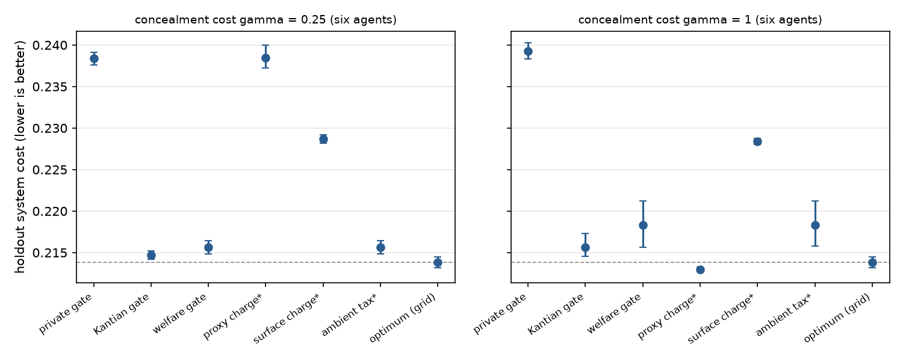

# Acceptance gates for co-evolving agents: pre-registered studies in a payment network and a shared codebase

Research report, 17 November 2026. Status: single-site, unreviewed,
unreplicated. Full detail, audit trail and decision log are in
[PROJECT.md](PROJECT.md); the frozen protocols are in
[PREREGISTRATION.md](PREREGISTRATION.md) and
[PREREGISTRATION_E8.md](PREREGISTRATION_E8.md) and
[PREREGISTRATION_E9.md](PREREGISTRATION_E9.md) and
[PREREGISTRATION_E10.md](PREREGISTRATION_E10.md).

## Abstract

Self-improving agent systems share a propose–evaluate–accept loop and are
usually evaluated against a fixed benchmark. When several such loops share an
environment, each accepted change alters the conditions under which the others
are evaluated. We isolate the acceptance gate as the experimental factor. Six
bank agents in a stylized real-time gross settlement network repeatedly mutate
a three-parameter liquidity policy; proposals, search budget and environment
are identical across arms and only the gate differs. In a pre-registered study
(20 paired seeds, 950 runs, five held-out shock families) private gates leave
the system 29 % more costly than a symmetric planner. A universalization gate,
which reads only the agent's own cost in the counterfactual where every agent
makes the same change, removes 51 % of that gap (95 % CI 41–63 %), with a
monotone dose response and transfer to every held-out family. Two registered
predictions failed: heterogeneity in bank size did not erode the gain, and a
single private defector did not profit. A unilateral welfare gate with full
cost visibility did worse than universalization, while a joint-move welfare
gate did best, indicating that evaluating coordinated changes matters more
than observing others' costs. A conventional delay surcharge with private
gates matched the best gate. A second pre-registered study (520 runs) widened
the price grid and replaced the three-parameter policy with an eight-parameter
rule-level one: the surcharge then beat every gate in both policy spaces,
while a coarser two-band tariff lost most of its effect with rule-level
policies. The gate is therefore a consequential design choice, but in this
environment it is dominated by a price on the externality. A third
pre-registered study (1 280 runs) moved to a second environment, agents
sharing a codebase, in which shortcuts add coupling to a shared debt stock and
incidents surface in random modules, so the harm cannot be attributed. There
the Kantian gate and a budget-breaking ambient tax reached practically the same
outcome (difference 0.4 % of cost; the gate's registered advantage did not
replicate with twelve agents), while every budget-balanced instrument either
had no effect or, in the case of a charge on visible coupling, was gamed into
concealment and made outcomes worse than no charge. A fourth pre-registered
study (1 080 runs) made incident exposure unequal across agents, the case in
which Kantian reasoning no longer measures the harm an agent imposes. The
ambient tax then beat the gate at both levels of inequality (by 0.0022 and
0.0060), the gate showed the distortion theory predicts (central agents
over-restrain, peripheral agents over-shortcut), and under a decision rule
fixed in advance the claim that gates beat the best available instrument is
closed. What remains is conditional: where only budget-balanced charges are
possible and the harm's carrier can be hidden, an own-cost gate beats those
charges, by a margin that shrinks as exposure becomes unequal.

## 1. Background

The payment-timing game is a standard example of privately rational behaviour
with collective cost: delaying payments to recycle incoming funds saves
liquidity for one bank and withholds it from others (Bech and Garratt 2003;
Galbiati and Soramäki 2011). Learning agents in such games have been studied
with reinforcement learning (Castro et al. 2021) and, in single-agent form,
with language models (BIS WP 1310). Stabilising mechanisms for societies of
language-model agents in financial coordination games are studied in FRAIL
(arXiv 2609.30940). Universalization has been used as a decision-time prompt
(Piatti et al., NeurIPS 2024). Kantian optimisation (Roemer) and *homo
moralis* preferences (Alger and Weibull 2013) supply the theory for a gate
parameterised by a degree of morality κ. We did not find prior work that
treats the acceptance rule of co-evolving agents as the experimental factor at
matched budget; our search was targeted, not systematic.

## 2. Method

**Environment.** Six banks, 20 ticks, integer money, no intraday credit.
Policy: opening liquidity fraction, buffer fraction, hold time. Sender-borne
costs: liquidity 1, full-day delay 0.5, deadline miss 2, unsettled at close
10. 85 % of payments lie on closed cycles so that liquidity serves timing
rather than net funding.

**Evolution.** 40 generations; each bank proposes four Gaussian mutations per
generation; each candidate is scored on 16 fresh development scenarios; the
best is accepted if the gate's score is negative; all banks update together.
Every gate spends the same number of simulations.

**Gates.** κ ∈ {0, 0.25, 0.5, 0.75, 1} mixes own cost under a unilateral
change (κ = 0, private) with own cost when all banks make the same shift
(κ = 1). Comparators: unilateral welfare, joint welfare, no-harm, private
gates under a delay surcharge chosen on development data, and a symmetric
planner.

**Evaluation.** Final profiles are scored on 100 held-out scenarios in each of
five families, four of them shocks never seen in evolution. Accounting
invariants are checked in every evaluation simulation. Statistics: paired by
seed, percentile bootstrap, Wilcoxon signed-rank, Holm correction where
registered.

**Integrity.** The evolution module cannot import the evaluator or construct
holdout scenarios (tested); the cost regime and budget were chosen on separate
pilot seeds and a separate scenario split; the protocol was committed before
confirmatory runs.

## 3. Results

Holdout system cost per unit of payment value, mean of five families.

| Arm | Cost (95 % CI) |
|---|---|
| private κ=0 | 1.125 (1.093–1.160) |
| κ=0.5 | 1.051 (1.030–1.074) |
| universalization κ=1 | 0.997 (0.973–1.021) |
| welfare, unilateral | 1.051 (1.010–1.100) |
| no-harm | 0.901 (0.881–0.921) |
| welfare, joint | 0.864 (0.851–0.878) |
| private + surcharge | 0.876 (0.858–0.894) |
| symmetric planner | 0.874 (0.839–0.911) |

Registered hypotheses: H1 supported (+29 %); H2 supported at the threshold
(closure 0.51); H2b supported (Spearman −0.58); H3 refuted (closure 0.51,
0.39, 0.52 across heterogeneity levels); H4 supported in all five families;
H5 refuted (defector gain +0.002, CI −0.004 to +0.008); H6 supported
(−0.054 against unilateral welfare).

Robustness: the universalization advantage holds for delay costs 0.1, 2 and 6
(closure 0.45–0.54), with sequential updates, with ten banks, and grows at
three times the budget (−0.186 against private on the same ten seeds).

Post hoc (E7, not registered): requiring a paired t-statistic below −2 for
acceptance preserves the ordering private > unilateral welfare >
universalization > surcharge, removes the no-harm gate's advantage, and makes
every arm much worse at this budget.

### 3.1 Second study: rule-level policies (E8)

Policies were extended to eight parameters (morning and afternoon buffers, an
opening tick, a size threshold with its own hold time, a bilateral net sending
limit), with the original space exactly nested. Budget and seeds as before.
Price levels were chosen on development cost.

| Arm | Three parameters | Eight parameters |
|---|---|---|
| private | 1.125 | 1.145 |
| universalization | 0.997 | 1.022 |
| welfare, unilateral | 1.051 | 1.059 |
| welfare, joint | 0.864 | 0.929 |
| private + delay surcharge | 0.815 | 0.863 |
| private + band tariff | 0.845 | 0.979 |
| symmetric planner | 0.874 | 0.934 |

Registered hypotheses: R1 supported (surcharge against universalization
−0.159, CI −0.180 to −0.138; against joint welfare −0.066, CI −0.091 to
−0.045); R2 not supported (gates do not degrade clearly more than the price,
interaction +0.017, CI −0.013 to +0.049); R3 supported (gate ordering holds);
R4 not supported as registered (the tariff degrades much more than the
surcharge, interaction +0.086, CI +0.050 to +0.123, but without the predicted
bunching before the band boundary).

### 3.2 Third study: an environment without a direct price (E9)

Protocol: [PREREGISTRATION_E9.md](PREREGISTRATION_E9.md). Six agents (twelve
in a secondary regime) own modules in a shared codebase and tune shortcut
intensity, the concealed share of the resulting coupling, and private
hardening. Coupling feeds a shared, slowly decaying debt stock; incidents
arrive in every module at a rate convex in the debt and surface wherever they
hit. An operator sees visible coupling, output, and where incidents surface;
not policies or concealed coupling. Four instruments on those observables were
tuned on development data: a charge on visible coupling, on output, on incident
loss in the agent's own module, and an ambient tax on incident loss in every
other module, charged to each agent in full (Segerson 1988; Holmström 1982).
The optimum is found by exhaustive search. Factor: the productivity cost of
concealment, γ ∈ {0.25, 1}; at γ = 1 concealment is pointless and the coupling
charge is a direct price (positive control).

In the primary regime (γ = 0.25, six agents) private gates cost 0.2384 against
an optimum of 0.2138 (+11 %). The Kantian gate reached 0.2147, closing 96 % of
the gap, as Kantian theory predicts for symmetric commons. The ambient tax at
its development-chosen level reached 0.2156, and its runs were identical to
those of the unilateral welfare gate, as theory implies. Under the registered
rule the gate is cheaper than the best instrument (+0.0009, 95 % CI +0.0002 to
+0.0016), so the registered kill criterion did not fire, contrary to the
pilot-based expectation. The difference lies inside the registered equivalence
margin, is absent with twelve agents (+0.0003, −0.0002 to +0.0009), and
reverses for the second-ranked ambient level (0.2136 on holdout); we read the
two as practically equivalent. Budget-balanced instruments fared badly: the
coupling charge was gamed (99 % of coupling concealed, cost 0.37), the output
charge had exactly no effect, and the best of them left 94 % of the gap open.
With γ = 1 the coupling charge matched or beat the gate, reproducing the
payment-environment result. A predicted advantage of the gate growing with the
number of agents did not appear.

### 3.3 Fourth study: unequal exposure (E10)

Protocol: [PREREGISTRATION_E10.md](PREREGISTRATION_E10.md). E9 used identical
agents, the case in which Kantian optimisation is known to be efficient. A
first pilot varied module size and changed nothing (size scales gain,
coupling and exposure alike); it is reported as a null. The registered study
varied incident exposure instead (rate multiplied by `rank^-skew`, mean 1), so
central modules absorb most incidents while every module adds coupling. The
optimum, now asymmetric, was found by coordinate descent; at skew 0 the study
reproduced E9 bit for bit.

The ambient tax was clearly cheaper than the best own-cost gate at skew 0.75
(−0.0022, CI −0.0027 to −0.0016) and skew 1.5 (−0.0060, −0.0069 to −0.0052),
and stayed within 0.0003 of the optimum. The Kantian gate's share of the
private-to-optimum gap fell from 0.96 to 0.67. Its policies showed the
predicted distortion: at skew 1.5 shortcut intensity rose from 0.45 for the
most exposed agent to 0.89 for the least exposed, against 0.64 to 0.73 at the
optimum. The gate still beat the best budget-balanced instrument at every
skew, but by +0.0007 at skew 1.5, inside the equivalence margin. The rule
registered in advance closes the strong claim.

## 4. Discussion

*Joint moves, not altruism.* The unilateral welfare gate is the textbook
cooperative learner and it underperforms a gate that never sees another
agent's cost. In this game improvements are visible only when several banks
shift together; a unilateral probe of a good joint direction looks bad. The
universalization gate works mainly as a way of evaluating coordinated moves.

*Pricing is enough here.* The surcharge needs no change to the agents and no
counterfactual simulation of others, and E8 shows it stays ahead when policies
are rule-level. The reason is structural: the externality runs through
settlement timing, and a charge on settlement time is equivalent to a charge
on delay, so the price sits on the externality itself. A gate can only matter
where no such price can be levied.

*Coarse prices are fragile.* The two-band tariff leaves delay inside each band
free. Rule-level banks under it delay about three times as long as under the
surcharge. This reading was made after the data and is not a registered
result.

*Without a direct price, the gate ties the textbook instrument.* In the
codebase environment the only instrument that matches the Kantian gate is an
ambient tax, which charges every agent the full loss it may have caused
elsewhere; at its natural level it is exactly the unilateral welfare gate. The
gate's practical edge is therefore not over pricing in general but over
*budget-balanced* pricing when the harm's carrier can be hidden: there a
charge on what the operator can see pushes the harm into what it cannot, a
multitask effect in the sense of Holmström and Milgrom (1991). Whether an
operator can break the budget, and whether agents are risk-neutral, decide
which instrument is preferable; E9 holds both fixed.

*Why the gate fails with unequal exposure.* Universalization asks "what would
it cost me if everyone made this change?". That equals the harm the agent
imposes on others only if everyone is equally exposed to it. When exposure is
unequal, the question measures what the agent would suffer, not what it
causes, so central agents over-restrain and peripheral ones over-reach. The
ambient tax charges what an agent imposes on others, whoever suffers it, and
has no such bias. This is a known property of Kantian equilibria rather than a
new result; E10 confirms it inside a learning loop.

*Failed predictions.* The absence of a heterogeneity effect and of a defector
gain may reflect the small policy space and noisy search rather than
properties of the gate. They are reported as registered and not interpreted
further.

## 5. Limitations

* Toy model: six banks, three parameters, uncalibrated costs, no
  liquidity-saving mechanism, 3–7 % of value left unsettled.
* The dilemma exists only under balanced flows; with independent flows all
  gates coincided.
* Acceptance is noise-dominated (about five of six proposals accepted per
  generation); the no-harm ranking is not robust to this.
* The symmetric planner is a weak reference; gap closure is understated
  relative to the best arm.
* Mutation-based proposals. No language model is involved, so the connection
  to self-evolving language-model agents is an analogy, not a result.
* Every arm is worse with eight parameters, including the planner, although
  the larger space contains the smaller. Search at fixed budget, not the
  policy space, limits those results.
* Two environments; E9 symmetric, E10 with one kind of heterogeneity
  (exposure) and one functional form. No claim of generality, and no claim about
  recursive self-improvement.
* E9 agents are risk-neutral and cannot collude, which removes the classic
  objections to ambient taxes; the incident process was calibrated on pilot
  data to produce a dilemma.
* Prior-art search was targeted; several 2026 preprints were read at abstract
  level only.

## 6. Next

The strong claim, that gates beat the best available instrument, is closed:
it fails in payments, ties with identical agents in the codebase, and fails
with unequally exposed agents. The only remaining test that could reopen it is
risk-averse agents facing a noisy ambient charge, which these studies exclude
by construction. Language-model proposers remain unstarted; in this testbed
they would be a study of proposals (can a stronger proposer exploit the
ambient tax or the proxy?), not of gates.

## References

* Alger, I., Weibull, J. (2013). Homo moralis. *Econometrica* 81(6).
* Bech, M., Garratt, R. (2003). The intraday liquidity management game. *J. Econ. Theory* 109(2).
* Castro, P. S., Desai, A., Du, H., Garratt, R., Rivadeneyra, F. (2021). Estimating policy functions in payments systems using reinforcement learning. Bank of Canada SWP 2021-7.
* Cochard, F., Willinger, M., Xepapadeas, A. (2005). Efficiency of nonpoint source pollution instruments: an experimental study. *Environ. Resour. Econ.* 30(4).
* Holmström, B. (1982). Moral hazard in teams. *Bell J. Econ.* 13(2).
* Holmström, B., Milgrom, P. (1991). Multitask principal–agent analyses. *J. Law Econ. Organ.* 7.
* Segerson, K. (1988). Uncertainty and incentives for nonpoint pollution control. *J. Environ. Econ. Manag.* 15(1).
* Fu, Z., Xu, R., Ren, Q. (2026). Financial fragility in societies of LLM agents. arXiv:2609.30940.
* Galbiati, M., Soramäki, K. (2011). An agent-based model of payment systems. *J. Econ. Dyn. Control* 35(6).
* Piatti, G. et al. (2024). Cooperate or collapse. NeurIPS 2024, arXiv:2404.16698.
* Qu, A. et al. (2026). CORAL. arXiv:2604.01658.
* Roemer, J. (2019). *How We Cooperate*. Yale University Press.
* Srikanth, D. et al. (2026). Recursive self-improvement of AI research agents. arXiv:2609.26457.
* Zhang, J. et al. (2026). Hyperagents. arXiv:2603.19461.
