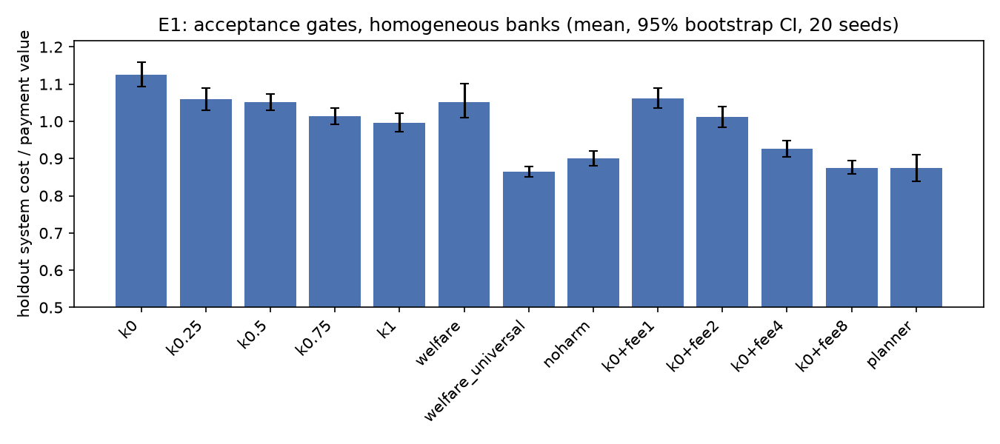
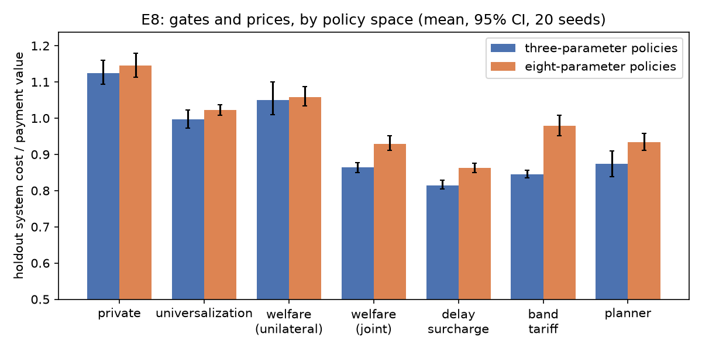
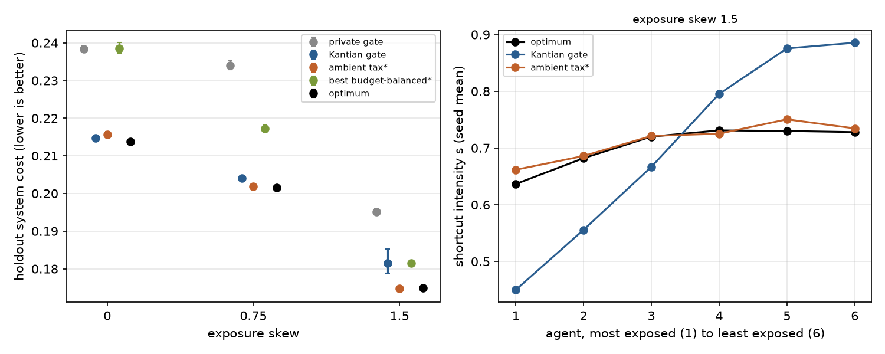

# Acceptance gates versus prices for co-evolving agents: four pre-registered studies in two environments

Final report of the gates line, 18 November 2026. Status: single-site,
unreviewed, unreplicated. The audit trail, decision log and per-study detail
are in [PROJECT.md](PROJECT.md). The frozen protocols are
[PREREGISTRATION.md](PREREGISTRATION.md) (E1–E6),
[PREREGISTRATION_E8.md](PREREGISTRATION_E8.md),
[PREREGISTRATION_E9.md](PREREGISTRATION_E9.md) and
[PREREGISTRATION_E10.md](PREREGISTRATION_E10.md).

## Abstract

Self-improving agent systems share a propose–evaluate–accept loop. When
several such loops share an environment, each accepted change alters the
conditions under which the others are evaluated, and changes that are good for
their owner can be bad for everyone. We ask whether the *acceptance rule*
alone can correct this, and whether it can do so better than a charge on the
externality that an operator could levy instead. Proposals, search budget and
environment are identical across arms; only the gate, or the price the agents
face, differs. Four pre-registered studies (3 830 confirmatory runs, 20 paired
seeds each, held-out evaluation scenarios) were run in two environments.

In a stylized real-time gross settlement network (E1–E6, E8), private gates
leave the system 29 % costlier than a symmetric planner. A universalization
(Kantian) gate, which reads only the agent's own cost when every agent makes
the same change, closes 51 % of that gap. A gate that evaluates joint moves
does better still. But a delay surcharge on private agents does better than
every gate, with three-parameter and with eight-parameter rule-level policies.

In a shared-codebase environment (E9, E10), harm is unattributable and its
carrier can be hidden, so no direct price exists. With identical agents the
Kantian gate and a budget-breaking ambient tax are practically equivalent
(difference 0.0009, 0.4 % of cost). Every budget-balanced charge either had no
effect or was gamed into concealment. When incident exposure is unequal, the
ambient tax beats the best gate (by 0.0022 and 0.0060 at two levels of
inequality). The gate shows the distortion our derivation predicts: a
Kantian point that is Pareto efficient but weights agents by one over their
exposure, so it misses the minimum of total cost. Under a
decision rule fixed in advance, the claim that gates beat the best available
instrument is therefore rejected.

What remains is conditional. Where only budget-balanced charges are possible
and the harm's carrier can be hidden, an own-cost Kantian gate beats those
charges. Its margin shrinks as exposure becomes unequal, and at the strongest
inequality tested it is within the equivalence margin. Several registered
predictions failed; they are listed in §5.

## 1. Question

Systems that improve themselves by proposing changes, scoring them and keeping
the ones that score well are now common (for example CORAL, Qu et al. 2026;
Hyperagents, Zhang et al. 2026; AIDE², Srikanth et al. 2026). They are
evaluated as single lineages, or as several agents pursuing one common
objective, against fixed benchmarks. In use, several such systems
owned by different principals share an environment: banks sharing a payment
system, teams sharing a codebase. Then a change that lowers its owner's cost
can raise everyone else's, and a loop that accepts on own cost reproduces a
social dilemma.

The loop has a natural control point that is neither the proposer nor the
environment: the **acceptance gate**. This work treats the gate as the
experimental factor and asks two questions.

1. Does the choice of gate change the outcome, at matched search budget?
2. Can a gate do better than the textbook alternative, a price on the
   externality chosen by an operator?

The second question decides whether gates are worth building. It was answered
in two environments chosen to make it progressively harder for the price:
one where the externality can be priced directly, and one where it cannot be
attributed.

## 2. Related work

A literature review covering 118 logged searches is in
[LITERATURE_REVIEW.md](LITERATURE_REVIEW.md). It is a broad structured review,
not a formal systematic one, and several sources were seen at abstract level
only. This section summarises it.

**Acceptance gates.** In 2026 the acceptance gate of a self-improving loop
became a research object in its own right, but only for single agents. SAGE
(arXiv:2609.36043) compares a statistical gate with a greedy one at matched
proposals and tokens. PACE (arXiv:2606.08106) compares greedy, fixed-sample,
false-discovery-rate and anytime-valid gates. Both name the multi-agent case
as open. Single-lineage systems such as the Darwin Gödel Machine and
Hyperagents compare archive-based acceptance with keeping only one successor.
The closest classical analogue is Agogino and Tumer's comparison of local,
global and difference evaluation for evolving multiagent policies. It is
fully cooperative, and it shapes fitness rather than accepting or rejecting
proposals. We did not find a comparison of per-agent gates among co-evolving
agents that impose costs on each other, nor one against a price.

**Kantian theory.** Roemer (2015) shows that additive and multiplicative
Kantian equilibria are Pareto efficient, including with heterogeneous agents.
Only the simple form, in which everyone takes the same action level, is
generally inefficient with heterogeneity. *Homo moralis* preferences (Alger
and Weibull 2013) give the degree-of-morality mixture κ. Our κ = 1 gate is the
additive form: every agent's policy moves by the same mutation. With unequal
exposure, the additive Kantian condition gives b′ᵢ = n·eᵢ·D′. The equal-weight
cost optimum gives b′ᵢ = n·ē·D′. So the Kantian point is the welfare optimum
with weights proportional to 1/exposure. That is efficient in Pareto's sense,
but not the minimum of total cost. This derivation is ours. It is not stated
in the sources we found, and E10 tests its prediction. Universalization has
been used as a decision-time prompt for language-model agents (Piatti et al.
2024). We did not find it used as the acceptance rule of a learning loop.

**Payment systems.** The payment-timing game is a standard example of
privately rational delay with collective cost (Bech and Garratt 2003;
Galbiati and Soramäki 2011). Learning agents in it have been studied with
reinforcement learning (Castro et al. 2025). A single prompted language-model
agent has been tested on cash-management decisions (Aldasoro and Desai 2025).
Pricing beating coordination rules has precedent: a time-rising intraday
tariff beats throughput guidelines in most cases (Ota 2011). Our surcharge
result extends that comparison to agent-level gates. Fu et al. (2026) compare
stabilising mechanisms for language-model agents in other financial
coordination games; there paid commitments were never the best mechanism.
Their agents are prompted, not evolved.

**Unattributable harm.** With output observed only in aggregate, no
budget-balanced sharing rule gives efficient incentives, and a budget breaker
can (Holmström 1982). The ambient tax on non-point pollution is the
corresponding instrument (Segerson 1988). Known objections include collusion,
large transfers and information requirements (Millock and Salanié 2005).
Laboratory evidence is mixed (Spraggon 2002; Cochard, Willinger and
Xepapadeas 2005; Suter et al. 2008). Charging each agent all damage outside
its module makes its payoff equal to private benefit minus total damage, a
Groves-style transfer. The level-1 identity between the ambient tax and the
unilateral welfare gate is therefore an observation, not a result. In
multi-agent reinforcement learning, LOPT (Hua et al. 2025) learns a Pigouvian
reward shaping toward social welfare where the externality can be
attributed. Paying on a measured dimension moves effort into unmeasured ones
(Holmström and Milgrom 1991; not re-read for this review).

**Technical debt.** Gavidia-Calderon et al. (2020) model technical debt as a
tragedy of the commons. In their simulation, two developers choose between a
kludge and a fix, and the only equilibrium is that both kludge. Code review
with enough detection restores fixing. Our codebase environment adds
continuous shortcut intensity, concealed coupling, hardening, incidents that
rise convexly with debt and land in random modules, operator charges, and
many evolving agents.

Every comparison here therefore builds on known pieces. What we add is a
matched-budget comparison of per-agent acceptance gates against prices among
co-evolving agents, in two environments. That comparison was not found in this
review.

## 3. Method

### 3.1 Common protocol

**Loop.** n agents, 40 generations. In each generation each agent proposes
four Gaussian mutations of its policy, scores each on 16 fresh development
scenarios, and accepts the best if the gate's score is negative. All agents
update together. Every arm spends the same number of simulations.

**Gates.** Each gate scores a candidate change by:

* *private* (κ = 0): own cost under the unilateral change;
* *universalization* (κ = 1): own cost when every agent makes the same shift;
* *κ ∈ (0, 1)*: a mixture of the two;
* *unilateral welfare*: total cost under the unilateral change;
* *joint welfare*: total cost under the joint shift;
* *no-harm* (payments only): no other agent made worse off.

The own-cost gates read only the agent's own cost; the welfare gates read
everyone's.

**Prices.** These are transfers added to private costs, with private gates.
Each price level is chosen on development cost in the last generation and
reported on holdout.

**Evaluation.** Final profiles are scored on 100 held-out scenarios in each of
five scenario families, four of them shocks never seen during evolution. The
outcome is system cost per unit of value, the equal-weight mean of the five
families.

**Statistics.** Seeds are the unit (20, paired across arms). We report the 95 %
percentile bootstrap (10 000 resamples) and the Wilcoxon signed-rank test,
with Holm correction where registered. "Clearly" means the interval excludes 0.
E9 and E10 add an equivalence margin of ±0.002.

**Integrity.**

* The evolution code cannot import the evaluator or construct holdout
  scenarios; a test checks this.
* Cost regimes, budgets and price grids were chosen on separate pilot seeds
  and a separate scenario split.
* Each protocol and its analysis script were committed before the
  confirmatory runs.
* Records carry the commit hash, and rerunning the analyses reproduces the
  reported results byte for byte.

### 3.2 Payment environment (E1–E6, E7, E8)

**Setup.** Six banks, 20 ticks, integer money and no intraday credit. 85 % of
payments lie on closed cycles, so that liquidity serves timing rather than net
funding.

**Policy.** Opening liquidity fraction, buffer fraction and hold time. E8
extends this to eight parameters (two buffers, an opening tick, a
large-payment threshold with its own hold time, and a bilateral sending
limit), with the original space exactly nested.

**Costs.** All borne by the sender: liquidity 1, full-day delay 0.5,
deadline miss 2, unsettled at close 10.

**Prices.** A delay surcharge proportional to the settlement tick; E8 adds a
coarser two-band tariff. The reference is a symmetric planner.

### 3.3 Codebase environment (E9, E10)

**Policy and debt.** Six agents (twelve in a secondary regime) own modules in
a shared codebase. Each tunes three numbers:

* shortcut intensity *s*, which raises output;
* concealed share *m* of the resulting coupling;
* private hardening *q*.

Coupling feeds a shared debt stock that decays slowly. Incidents arrive in
every module at a rate convex in the debt, and surface wherever they hit.
Concealed coupling is invisible to the operator, costs its author a share γ
of the shortcut's gain and adds 50 % more debt.

**Operator's view.** The operator sees visible coupling, output, and where
incidents surface. It does not see policies or concealed coupling.

**Instruments**, all on observables:

* *proxy*: a charge on visible coupling;
* *activity*: a charge on output;
* *surface*: a charge on incident loss in the agent's own module;
* *ambient tax*: a charge on incident loss in every *other* module, levied on
  each agent in full. This is the budget-breaking Segerson–Holmström form; at
  level 1 it is identical to the unilateral welfare gate (a tested identity;
  a Groves-style observation, §2).

**Optimum.** E9 finds it by exhaustive search over symmetric profiles. E10
uses coordinate descent from there over asymmetric profiles.

**Exposure (E10 only).** E10 multiplies agent *a*'s incident rate by
`rank^-skew` (mean 1), so central modules absorb most incidents while every
module still adds coupling.

## 4. Results

### 4.1 Gates in the payment network (E1–E6)

Holdout cost per unit of payment value, six banks, delay cost 0.5:

| Arm | Reads | Cost (95 % CI) |
|---|---|---|
| private κ=0 | own | 1.125 (1.093–1.160) |
| κ=0.5 | own | 1.051 (1.030–1.074) |
| universalization κ=1 | own | 0.997 (0.973–1.021) |
| welfare, unilateral | all | 1.051 (1.010–1.100) |
| no-harm | all | 0.901 (0.881–0.921) |
| welfare, joint | all | 0.864 (0.851–0.878) |
| private + delay surcharge (grid to level 8) | own | 0.876 (0.858–0.894) |
| symmetric planner | all | 0.874 (0.839–0.911) |

* The private gate is 29 % costlier than the planner (H1).
* Universalization closes 51 % of the gap (41–63 %; H2), and cost falls
  monotonically in κ (H2b).
* The gain transfers to every held-out shock family (H4).
* Universalization beats the unilateral welfare gate (−0.054, H6). That gate
  sees every bank's cost, yet a unilateral probe of a good joint direction
  looks bad to it. Evaluating coordinated moves matters more than seeing
  others' costs: the joint-welfare gate is the best gate.
* Robustness: the universalization advantage holds at delay costs 0.1, 2 and 6
  (closure 0.45–0.54), with sequential updates and with ten banks. It grows
  at three times the budget.

**Failed predictions.**

* Heterogeneity in bank size did not erode the gain (H3; closure 0.51, 0.39
  and 0.52).
* A single private defector among universalizing banks did not profit (H5;
  +0.002, CI −0.004 to +0.008).

**Post hoc (E7, not registered).** Requiring a paired t-statistic below −2
for acceptance preserves the ordering of gates. It removes the no-harm gate's
advantage and makes every arm much worse at this budget.

### 4.2 Gates against pricing with rule-level policies (E8)

E1's surcharge grid stopped at level 8. E8 widened it to 32 and added
eight-parameter policies; the level chosen on development cost was 16. The
four gate arms reproduce E1 to the last digit.

| Arm | Three parameters | Eight parameters |
|---|---|---|
| private | 1.125 | 1.145 |
| universalization | 0.997 | 1.022 |
| welfare, unilateral | 1.051 | 1.059 |
| welfare, joint | 0.864 | 0.929 |
| private + delay surcharge (level 16) | **0.815** | **0.863** |
| private + band tariff | 0.845 | 0.979 |
| symmetric planner | 0.874 | 0.934 |

* **The surcharge beats every gate (R1).** Against universalization the
  difference is −0.159 (−0.180 to −0.138); against joint welfare it is −0.066
  (−0.091 to −0.045).
* **The gate ordering survives (R3).**
* **R2 failed.** Gates did not degrade with richer policies clearly more than
  the price did (interaction +0.017, −0.013 to +0.049).
* **R4 failed as registered.** The coarse tariff lost far more than the
  surcharge with rule-level policies (interaction +0.086, +0.050 to +0.123),
  but not through the registered mechanism of bunching before the band.
  Post hoc, the tariff leaves delay inside each band unpriced, and rule-level
  banks use that.
* **Every arm is worse with eight parameters,** including the planner,
  although the larger space contains the smaller. This is a search effect at
  fixed budget.

The surcharge works because a charge on settlement tick prices the
externality channel itself.

### 4.3 No direct price: the shared codebase (E9)

Primary regime: γ = 0.25 (concealment is cheap), six agents. Holdout cost:

| Arm | Cost (95 % CI) | Concealed share |
|---|---|---|
| optimum | 0.2138 (0.2132–0.2145) | 0.00 |
| **Kantian gate** | **0.2147** (0.2142–0.2152) | 0.00 |
| **ambient tax, level 1** (chosen on development data; = unilateral welfare gate) | **0.2156** (0.2148–0.2165) | 0.00 |
| ambient tax, level 1.5 (not chosen) | 0.2136 (0.2131–0.2141) | 0.00 |
| surface charge, level 4 | 0.2287 (0.2282–0.2292) | 0.00 |
| welfare gate, joint shift | 0.2348 (0.2318–0.2383) | 0.00 |
| private gate | 0.2384 (0.2376–0.2391) | 0.00 |
| output charge, any level | identical to private gate | 0.00 |
| proxy charge, level 0.1 (best budget-balanced on development data) | 0.2385 (0.2373–0.2400) | 0.01 |
| proxy charge, levels 0.2–0.8 | 0.366–0.369 | 0.98–1.00 |

* **The dilemma exists.** The private gate is 11 % above the optimum (C1).
* **The Kantian gate closes 96 % of the gap (C2),** as theory predicts for
  identical agents.
* **The registered kill criterion did not fire (C5).** Against the best
  instrument, the gate is cheaper by +0.0009 (+0.0002 to +0.0016), contrary to
  the pilot-based expectation. That is a failed prediction. The difference is
  inside the equivalence margin, absent with twelve agents (+0.0003, −0.0002
  to +0.0009), and reversed by the second-ranked ambient level. We read the
  two as practically equivalent.
* **Budget-balanced charges fail when the carrier can be hidden (C4, C5b).**
  Any proxy level strong enough to bind is gamed into concealment, a multitask
  effect. The output charge only rescales own cost and has exactly no effect.
  The level chosen on development data leaves the whole gap open. Against
  these, the gate wins by 0.024 (C5b).
* **Positive control (γ = 1).** When concealment is pointless, the proxy is a
  direct price and beats the gate with six agents (−0.0027). C3 failed with
  twelve agents (+0.0006, inside the margin).
* **C7 failed.** A predicted advantage of the gate growing with the number of
  agents did not appear.
* **Post hoc.** The joint-shift welfare gate, best in payments, is the worst
  cooperative gate here: its score sums every agent's noisy cost.

### 4.4 Unequal exposure (E10)

E9's agents were identical, the easiest case for the Kantian gate. A first
pilot varied module size and changed nothing, because size scales gain,
coupling and exposure alike; it is reported as a null. The registered study
varied incident exposure. At skew 0 its 320 runs shared with E9 reproduce E9
bit for bit.

| | skew 0 | skew 0.75 | skew 1.5 |
|---|---|---|---|
| private gate | 0.2384 | 0.2340 | 0.1951 |
| κ = 0.5 gate | 0.2342 | 0.2122 | 0.1808 (chosen) |
| Kantian gate κ = 1 | 0.2147 (chosen) | 0.2040 (chosen) | 0.1816 |
| ambient tax, level 1 (chosen at every skew) | 0.2156 | **0.2018** | **0.1747** |
| best budget-balanced (proxy 0.1) | 0.2385 | 0.2172 | 0.1815 |
| optimum (asymmetric) | 0.2137 | 0.2015 | 0.1749 |

"Chosen" marks the own-cost gate selected on development data.

* **The ambient tax beat the best own-cost gate at both unequal levels (D2).**
  At skew 0.75: −0.0022 (−0.0027 to −0.0016). At skew 1.5: −0.0060 (−0.0069
  to −0.0052). It stayed within 0.0003 of the optimum.
* **The Kantian gate's share of the gap fell** from 0.96 to 0.67 at skew 1.5
  (D3; the change at 0.75 is not clear).
* **The gate showed the predicted distortion (D4).** At skew 1.5, shortcut
  intensity under it rose from 0.45 for the most exposed agent to 0.89 for the
  least exposed. At the optimum the range is 0.64 to 0.73. The ambient tax
  showed no such spread.
* **The gate still beat the best budget-balanced charge at every skew (D5),
  but the margin shrank:** +0.024, +0.013 and +0.0007. The last is inside the
  equivalence margin.
* **The identity held:** ambient level 1 equals the unilateral welfare gate
  (D6).
* **Post hoc:** at skew 1.5 the development data chose κ = 0.5 over κ = 1.

**Decision.** The strong claim needed the gate to beat the best instrument by
more than 0.002 at both unequal levels. It lost at both, so under the rule
registered in advance the line is closed. This was the outcome the pilot and
the theory predicted; the test could have gone the other way.

## 5. Registered predictions and outcomes

| Study | Prediction | Outcome |
|---|---|---|
| E1–E6 | H1 private gate ≥ 5 % above planner | Held (+29 %) |
| | H2 universalization closes ≥ half the gap | Held at the threshold (0.51) |
| | H2b cost falls with κ | Held |
| | H3 heterogeneity erodes the gain | **Failed** |
| | H4 gain transfers to every held-out family | Held |
| | H5 a private defector gains | **Failed** |
| | H6 universalization beats unilateral welfare | Held |
| E8 | R1 price matches or beats gates | Held |
| | R2 gates degrade more with richness than price | **Failed** |
| | R3 gate ordering survives | Held |
| | R4 coarse price gamed by bunching | **Failed** (degrades, other mechanism) |
| E9 | C1 dilemma | Held |
| | C2 Kantian gate closes ≥ 80 % | Held (validity check) |
| | C3 positive control: proxy not worse at γ = 1 | Held at n = 6, **failed** at n = 12 |
| | C4 proxy gamed at γ = 0.25 | Held |
| | C5 kill criterion expected to fire | **Failed**: gate ahead by 0.0009, within margin |
| | C5b gate beats budget-balanced | Held at γ = 0.25 |
| | C6 identities | Held |
| | C7 gate's edge grows with n | **Failed** |
| E10 | D1 dilemma | Held |
| | D2 ambient tax beats gate when exposure is unequal | Held |
| | D3 closure falls with skew | Held at 1.5, not clear at 0.75 |
| | D4 Kantian distortion | Held |
| | D5 gate beats budget-balanced at every skew | Held, shrinking to within margin |
| | D6 identity | Held |

## 6. Discussion

**What the gate does.** In the payment game, gains appear only when several
banks shift together, so a unilateral probe of a good joint direction looks
bad. The universalization gate works mainly by evaluating coordinated moves;
the joint-welfare gate does the same with more information. In the codebase
environment with identical agents, the Kantian gate is efficient, as Roemer's
theory predicts.

**Why a price wins where one exists.** In payments the externality runs
through settlement timing, and a charge on settlement time prices that
channel directly. It needs no change to the agents and no counterfactual
simulation of others. Richer policies did not erode it, but a coarse price is
fragile: richer policies exploit what it leaves unpriced.

**Why the ambient tax wins where no direct price exists.** The ambient tax
charges each agent what it imposes on others, whoever suffers it. The Kantian
question "what if everyone did this?" equals that harm only when everyone is
equally exposed. With unequal exposure it measures what the agent would
*suffer*. Central agents then over-restrain and peripheral agents
over-shortcut. The additive Kantian point is still Pareto efficient: it is the
optimum for a planner who weights each agent by one over its exposure (§2).
It is not the minimum of total cost, which is the outcome measured here. The
derivation is ours, not taken from the literature; E10 confirms its
prediction inside a learning loop.

**What survives.** The gate's practical role is narrow. Where an operator can
neither price the carrier of harm (because it can be hidden) nor break the
budget, every budget-balanced charge fails: it is gamed or neutral. An
own-cost Kantian gate then does much better when agents are alike, and only
slightly better when they are not. Whether an operator can break the budget,
whether agents are risk-averse, and whether they can collude decide between
the gate and the ambient tax. These studies hold all three fixed in the
ambient tax's favour.

## 7. Limitations

* **Toy models.**
  * Payments: six banks, uncalibrated costs, no liquidity-saving mechanism,
    and 3–7 % of value left unsettled. The dilemma exists only under balanced
    flows.
  * Codebase: one functional form, an incident process calibrated on pilot
    data to produce a dilemma, and one kind of heterogeneity.
* **Weak search.** Mutation proposals over three or eight bounded numbers.
  Acceptance is noise-dominated (about five of six proposals accepted per
  generation in payments). Every arm degrades with richer policies at fixed
  budget.
* **Imperfect references.**
  * The payment planner is symmetric, so gap closure there is understated.
  * The codebase optimum is a grid and coordinate-descent optimum, possibly
    local; the ambient tax came within 0.0003 of it.
* **Favourable assumptions for the ambient tax.** Agents are risk-neutral and
  cannot collude, which removes the classic objections to it.
* **No language models.** Proposals are random mutations, so the link to
  self-improving language-model systems is an analogy, not a result.
* **Prior-art review** was broad and structured but not a formal systematic
  review; several sources were seen at abstract level only
  ([LITERATURE_REVIEW.md](LITERATURE_REVIEW.md)).

## 8. Conclusion

Across two environments and four pre-registered studies, the acceptance gate
is a consequential design choice, but it is not a substitute for a
well-chosen price. A price on the externality matches or beats every gate
tested:

* a delay surcharge where the channel is observable;
* an ambient tax where it is not.

A Kantian own-cost gate is a strong default only where neither is available.
Its advantage over budget-balanced charges shrinks as agents become unequal.

The line is closed. Three things could reopen it, none of them in scope here:

* risk-averse agents facing a noisy ambient charge;
* collusion against the ambient tax;
* open-ended action spaces, such as agents that edit real code under a
  sandbox. There a stronger proposer might find exploits of prices that
  mutation search cannot.

## Reproducibility

Code, raw records and analysis scripts are in this repository; commands are
in [PROJECT.md §8](PROJECT.md#8-reproduce). The confirmatory runs take about
four hours on a laptop. Results are deterministic given the commit,
and the analysis scripts regenerate the result files exactly from the stored
records.

## References

Evidence levels for each source are given in
[LITERATURE_REVIEW.md](LITERATURE_REVIEW.md).

* Agogino, A., Tumer, K. (2005). Coordinating multi-rover systems: evaluation functions for dynamic and noisy environments. GECCO 2005, 591–598.
* Aldasoro, I., Desai, A. (2025). AI agents for cash management in payment systems. BIS Working Paper 1310; Bank of Canada SWP 2025-35.
* Alger, I., Weibull, J. (2013). Homo moralis. *Econometrica* 81(6).
* Bech, M., Garratt, R. (2003). The intraday liquidity management game. *J. Econ. Theory* 109(2).
* Castro, P. S., Desai, A., Du, H., Garratt, R., Rivadeneyra, F. (2025). Estimating policy functions in payments systems using reinforcement learning. *ACM Trans. Econ. Comput.* 13(1). Earlier as Bank of Canada SWP 2021-7.
* Cochard, F., Willinger, M., Xepapadeas, A. (2005). Efficiency of nonpoint source pollution instruments: an experimental study. *Environ. Resour. Econ.* 30(4).
* Fu, Z., Xu, R., Ren, Q. (2026). Financial fragility in societies of LLM agents. arXiv:2609.30940.
* Galbiati, M., Soramäki, K. (2011). An agent-based model of payment systems. *J. Econ. Dyn. Control* 35(6).
* Gavidia-Calderon, C., Sarro, F., Harman, M., Barr, E. T. (2020). Game-theoretic analysis of development practices: challenges and opportunities. *J. Syst. Softw.* 159, 110424.
* Holmström, B. (1982). Moral hazard in teams. *Bell J. Econ.* 13(2).
* Holmström, B., Milgrom, P. (1991). Multitask principal–agent analyses. *J. Law Econ. Organ.* 7.
* Hua, Y. et al. (2025). Learning optimal Pigouvian taxes in multi-agent reinforcement learning (LOPT). NeurIPS 2025.
* Millock, K., Salanié, F. (2005). Nonpoint source pollution and cooperation. *Topics Econ. Anal. Policy* 5(1).
* Ota, T. (2011). Intraday two-part tariff in payment systems. Bank of England Working Paper 428.
* PACE (2026). arXiv:2606.08106.
* Piatti, G. et al. (2024). Cooperate or collapse. arXiv:2404.16698.
* Qu, A. et al. (2026). CORAL. arXiv:2604.01658.
* Roemer, J. (2015). Kantian optimization: a microfoundation for cooperation. *J. Public Econ.* 127, 45–57.
* Roemer, J. (2019). *How We Cooperate*. Yale University Press.
* SAGE (2026). arXiv:2609.36043.
* Segerson, K. (1988). Uncertainty and incentives for nonpoint pollution control. *J. Environ. Econ. Manag.* 15(1).
* Spraggon, J. (2002). Exogenous targeting instruments as a solution to group moral hazards. *J. Public Econ.* 84(3).
* Srikanth, D. et al. (2026). Recursive self-improvement of AI research agents. arXiv:2609.26457.
* Suter, J. F., Vossler, C. A., Poe, G. L., Segerson, K. (2008). Experiments on damage-based ambient taxes for nonpoint source polluters. *Am. J. Agric. Econ.* 90(1).
* Zhang, J. et al. (2026). Hyperagents. arXiv:2603.19461.
